<p align="center">
  
</p>

<h1 align="center">Nullstar</h1>

<p align="center"><em>Self-hosted watch tool for new security code on GitHub.</em></p>

<p align="center">
  <a href="https://github.com/0xKuraishY/NullStar/stargazers"></a>
  <a href="https://github.com/0xKuraishY/NullStar/network/members"></a>
  <a href="https://github.com/0xKuraishY/NullStar/issues"></a>
  <a href="https://github.com/0xKuraishY/NullStar/commits"></a>
  <a href="LICENSE"></a>
  <br>
  
  
  
  
  
</p>

GitHub ranks by popularity, which means anything published today sits at the
bottom of every list. Nullstar ranks by what a project is and how new it is
instead, so a proof of concept pushed this morning by an account nobody has
heard of can come out above a framework with forty thousand stars.

Reading it needs no account. Sign up if you want to save things, file them into
collections and keep notes.

Status: works, runs in production for me, API and schema still move between
releases. Issues and pull requests welcome.

**[Francais plus bas](#nullstar-francais)**

<p align="center">
  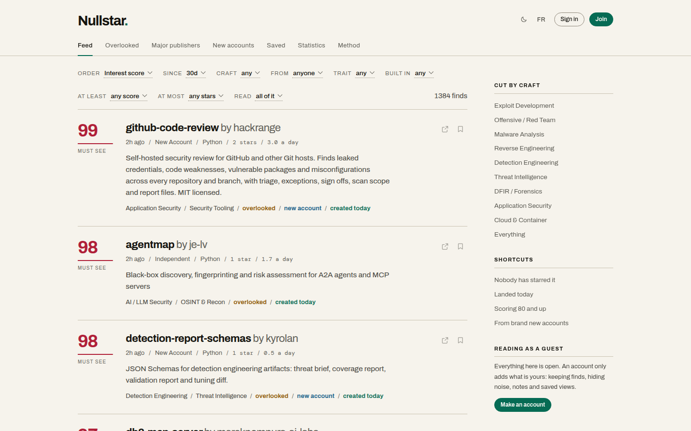
</p>

<table>
  <tr>
    <td width="50%">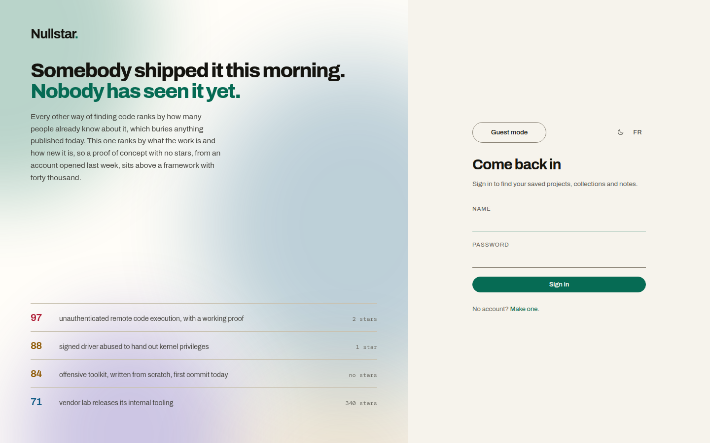<br><sub>Landing page: sign in, sign up, or guest mode</sub></td>
    <td width="50%">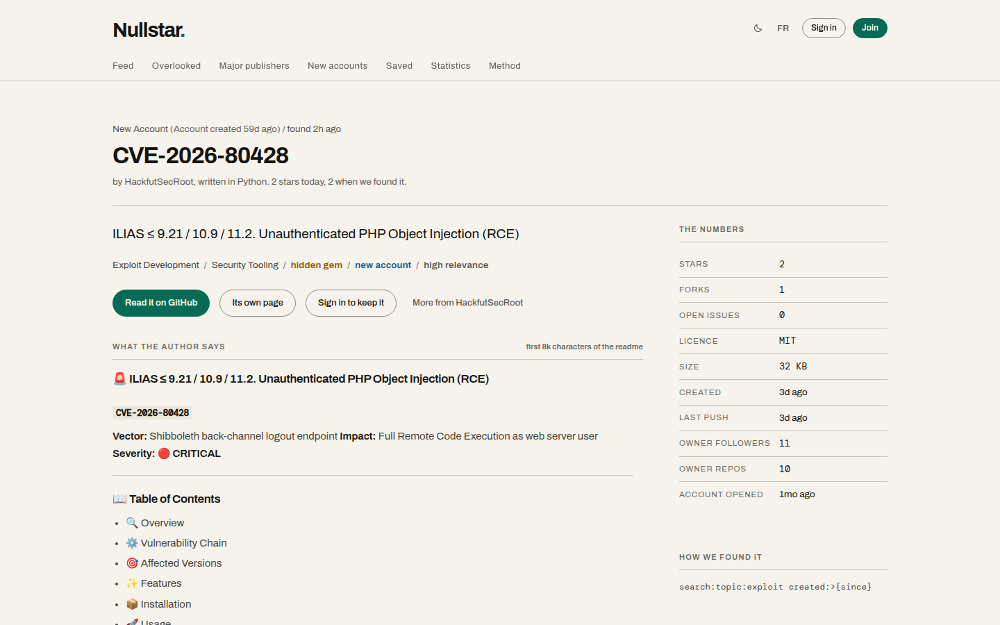<br><sub>Repository page with the sanitised readme and the numbers</sub></td>
  </tr>
  <tr>
    <td width="50%">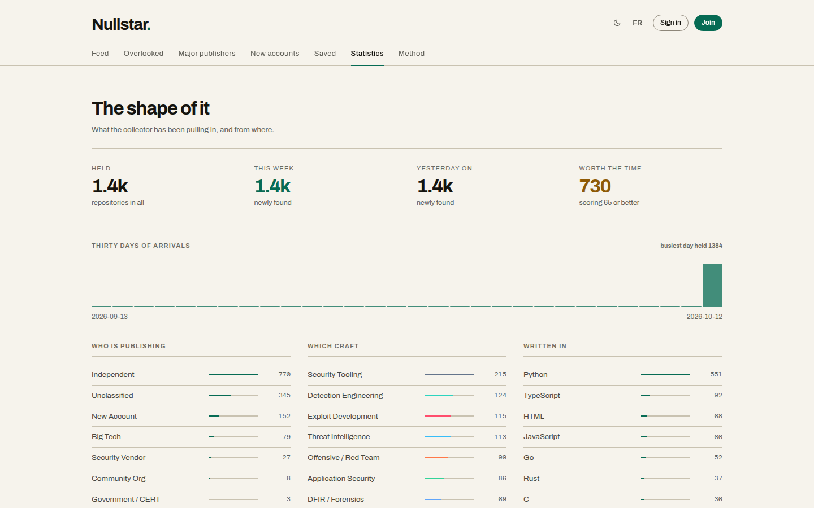<br><sub>Statistics: who publishes, which domain, which language</sub></td>
    <td width="50%">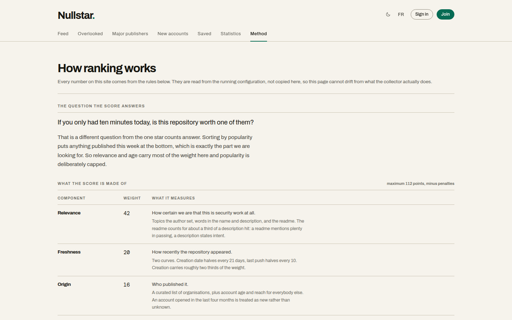<br><sub><code>/how</code>, the scoring method generated from the live configuration</sub></td>
  </tr>
  <tr>
    <td colspan="2">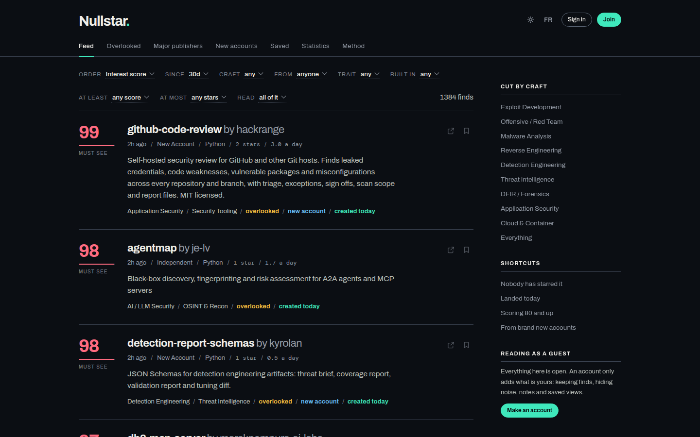<br><sub>Dark mode</sub></td>
  </tr>
</table>


## Running it

```
cp .env.example .env
$EDITOR .env
docker compose up -d --build
```

Open http://127.0.0.1:8080. A first visit lands on the sign-in page, which is
also the landing page: it explains what the thing is and offers three doors,
sign in, sign up, or **Guest mode**. Guest mode is remembered, so you only see
that page once.

Nothing is behind a sign-up wall. The feed, the presets, repository pages, the
charts, the method page and the live stream all work for an anonymous visitor,
and a direct link to a repository or a shared collection opens on itself
without any detour.

An account exists only for what belongs to one person: saved projects,
collections, notes and API keys. The first account made is the administrator of
the instance.

A GitHub token is not required but you want one. Without it the collector is
capped at 60 requests an hour, which is not enough to do anything useful. With
one you get 5000. A read-only classic token with no scopes is enough, since
everything it reads is public. You can also paste it later in the admin
settings instead of putting it in the file.

| Variable | What it does |
| --- | --- |
| `SECRET_KEY` | Signs session cookies. Change it. `python3 -c "import secrets;print(secrets.token_urlsafe(48))"` |
| `POSTGRES_PASSWORD` | Change it too |
| `GITHUB_TOKEN` | Read-only PAT |
| `BIND_ADDR`, `HTTP_PORT` | Defaults to 127.0.0.1:8080. Only expose it wider behind TLS |
| `COOKIE_SECURE` | Set true once you serve over HTTPS |
| `ROLLING_INTERVAL_SECONDS` | Seconds between collection cycles, default 90 |
| `ROLLING_BATCH_SIZE` | Sources polled per cycle, default 2 |
| `MAX_API_CALLS_PER_RUN` | Hard ceiling, default 900 |
| `ALERT_WEBHOOK_URL` | Optional Slack or Discord hook for high scores |

Shortcuts: `make up`, `make logs`, `make collect`, `make test`, `make reset`.

It also runs without Docker, on SQLite:

```
python3 -m venv .venv && .venv/bin/pip install -r requirements.txt
.venv/bin/uvicorn app.main:app --host 127.0.0.1 --port 8080
```


## Where it looks

Four kinds of source, all editable from the admin pages.

**Search queries.** About thirty five. Some are topic based (`topic:exploit`,
`topic:llm-security`), some are intent based (`"proof of concept" exploit`,
`rce OR lpe OR sandbox-escape`). The intent ones matter more than they look:
most new work is never tagged, and that is where the zero star repos are.

**Organisations.** Around forty five, from Meta, Google and Project Zero
through Trail of Bits, Project Discovery, NCC, Bishop Fox, SpecterOps,
Synacktiv and Quarkslab, down to CISA, the NSA and ANSSI.

**Starred by.** What a short list of researchers has just starred. The earliest
signal there is: someone who knows the field starring an unknown repo usually
beats everybody else by days.

**Users.** One person's own output.

Collection is continuous. Instead of one sweep an hour, a cycle every ninety
seconds polls the two sources nobody has looked at in the longest. With eighty
odd sources each comes round about hourly, but results arrive in a trickle and
the API quota is spent evenly rather than in a burst that trips GitHub's
secondary limiter. A full sweep still runs every few hours so a source that
keeps erroring cannot quietly drop out of rotation.

**New, not merely updated.** Organisation listings are mostly years old. A
repository created longer ago than `max_repo_age_days` (60 by default) is
skipped even if it was pushed to an hour ago. The point is work that did not
exist last month, not long-running projects that received a commit.


## How the score works

One question: if you only had ten minutes today, is this worth one of them.

| Part | Weight | What it measures |
| --- | --- | --- |
| Relevance | 42 | How sure we are this is security work. Topics, description, readme, twenty domain vocabularies |
| Freshness | 20 | Age, half life 21 days, plus last push, half life 10 days |
| Origin | 16 | Big tech, vendor, lab, government, community, known researcher, new account |
| Substance | 12 | Description, readme depth, topics, licence, size |
| Momentum | 10 | Stars per day, compressed hard so popularity cannot take over |
| Overlooked bonus | +12 | Relevant, recent, almost nobody has seen it |
| Noise penalty | -30 | Reading lists, course material, forks, archived repos |

Every repo page shows its own arithmetic, including which keywords matched. The
weights are editable, and rescoring the whole archive does not touch the GitHub
API.

The running instance publishes all of this at **`/how`**, a page open to
everybody that is generated from the live configuration rather than from a copy,
so it cannot drift from what the collector actually does.

Working out who owns a repo costs an API call, so it only happens once a cheap
relevance check passes.


## Accounts

Reading is open. The feed, the presets, repo pages, the charts and the live
stream all work with no account.

Sign up asks for a name and a password. There is no email field, on purpose: an
email here would be one more thing to lose in a breach and it buys nothing,
since there is no mail to send.

An account gets you:

- saving repos, and hiding the ones you do not want to see again
- collections: folders you name and colour. A repo can be in several. Sort by
  when you added it, by score, by stars, by age, by name, or your own order
- a share link per collection, readable by anyone, revocable, rotatable
- private notes, on a repo and on why you filed it where you filed it
- following GitHub accounts, so their new work is flagged
- saved filters and API keys

The first account made is the administrator. Open sign up is on by default and
an administrator can turn it off, after which `/register` only takes a single
use invite link. Three roles: admin, analyst, viewer.


## Security

| Problem | What handles it |
| --- | --- |
| XSS | Jinja autoescaping throughout, plus a readme sanitiser that strips tags rather than rendering them. CSP with `script-src 'self'`, no `unsafe-inline`, no `unsafe-eval` |
| SQL injection | ORM with bound parameters everywhere. No string built SQL |
| Integer overflow | Numeric query parameters are parsed and clamped. SQLite raises past 2**63 and that is a 500 from a URL |
| CSRF | Double submit token on every mutating form, constant time compare |
| Open redirect | `next` has to be an internal path. `//host`, `/\host`, a scheme or a control character all collapse to `/` |
| Password cracking | Argon2id, rehashed on sign in when parameters change |
| Credential stuffing | Per account lockout plus a per address limit across all accounts |
| Sign up flooding | Per address limit on account creation |
| Clickjacking | `X-Frame-Options: DENY`, `frame-ancestors 'none'` |
| Session theft | Signed HttpOnly SameSite cookie over a database session the user or an admin can revoke |
| SSRF | The alert webhook only accepts http and https |
| Leaking to third parties | No CDN, self hosted fonts, `connect-src 'self'`, `Referrer-Policy: no-referrer` |

The test suite includes a hostile input battery that fires script, SQL,
traversal and template payloads at every query parameter and then parses the
resulting HTML to check no element or event handler was created.

Two real holes were found by those tests while building this, both fixed: a
`/\host` redirect that browsers treat as protocol relative, and an unclamped
star filter that crashed SQLite.


## Readmes

A readme is Markdown with arbitrary HTML in it. Printing it raw shows the reader
literal `<div align="center">` and badge syntax. Rendering it as HTML hands an
untrusted document your page, which is stored XSS.

So `app/readme.py` drops every tag, removes badges and logos, converts the
Markdown that carries meaning and escapes the rest. Text inside backticks is
held back from the tag stripping, so a readme that writes `<div>` on purpose
still shows it. It is a preview, not a reproduction.


## Interface

Light by default, dark if you ask. The choice is a cookie and also sits on your
account, so the page is already right on the first paint instead of flashing the
wrong theme.

English and French. Only the interface is translated: repo names, descriptions
and readme text are left exactly as their authors wrote them. The language is a
cookie too, and follows an account across devices.

Select menus are a custom listbox, because a native select cannot be styled past
its closed state. The real select stays in the DOM, hidden, so forms submit the
same values and everything works with JavaScript off. Keyboard, type ahead and a
filter field on long lists are all handled.

Every text colour clears WCAG AA against its background in both themes.
Keyboard: `/` or `:` opens the command palette, `g` then `w h m f s d o` jumps
between sections.


## Layout

```
app/
  main.py                 app wiring, scheduler, security headers
  config.py  db.py        settings, engine, migrations
  models.py               tables
  security.py             passwords, sessions, CSRF, API keys, throttling, audit
  deps.py  queries.py     dependencies, rendering, feed queries
  taxonomy.py             twenty security domains, keyword rules, noise detection
  scoring.py              the ranking
  readme.py               readme sanitiser
  collections.py          user folders
  i18n.py                 translation
  store.py                settings held in the database
  collector/
    github.py             REST client with rate limit and budget accounting
    known.py              curated publisher tiers
    seeds.py              default sources
    pipeline.py           fetch, normalise, tier, score, store, enrich, alert
  routers/                auth, feed, library, admin, api
  templates/  static/     server rendered, hand written CSS, self hosted fonts
tests/
```

FastAPI, SQLAlchemy 2, PostgreSQL, APScheduler, Jinja2. No JavaScript framework
and no CDN.


## API

Make a key on your account page.

```
curl -H "Authorization: Bearer nsk_..." \
  "http://127.0.0.1:8080/api/v1/repos?min_score=70&window=7d&signal=hidden-gem"
```

| Route | What it gives |
| --- | --- |
| `GET /api/v1/repos` | The feed, paginated, takes every filter the web page takes |
| `GET /api/v1/repos/{id}` | One repo with its score breakdown |
| `GET /api/v1/taxonomy` | Domains and publisher tiers |
| `GET /api/v1/stats` | Counters |
| `GET /feed.atom?key=...` | Atom, for a reader |
| `GET /export.json` | Bulk export |
| `GET /stream` | Server sent events, new finds as rendered rows |

Interactive docs at `/api/docs`.


## Operating it

- A run holds a process wide lock. Rolling cycles, the full sweep and a manual
  trigger cannot overlap.
- Rolling mode writes a run row per cycle, history is capped at the last 400.
- On SQLite the engine turns on WAL, a 30 second busy timeout and foreign keys.
  Without WAL a collection run blocks every page load. Postgres needs none of it.
- A run killed by a restart is marked interrupted on the next boot.
- Retention drops low scoring records older than `retention_days`.


## Contributing

```
python3 -m venv .venv
.venv/bin/pip install -r requirements.txt
.venv/bin/python -m pytest tests -q
```

Tests run on SQLite and need no network. If you touch scoring or the sanitiser,
add a case. If you add a source that works well, send it: the seed list is the
most useful thing to grow.


## Licence

MIT, see LICENSE.


---
---


<a name="nullstar-francais"></a>

<p align="center">
  
</p>

<h1 align="center">Nullstar (francais)</h1>

<p align="center"><em>Outil de veille auto-heberge pour le nouveau code de securite publie sur GitHub.</em></p>

<p align="center">
  <a href="https://github.com/0xKuraishY/NullStar/stargazers"></a>
  <a href="https://github.com/0xKuraishY/NullStar/network/members"></a>
  <a href="https://github.com/0xKuraishY/NullStar/issues"></a>
  <a href="https://github.com/0xKuraishY/NullStar/commits"></a>
  <a href="LICENSE"></a>
  <br>
  
  
  
  
  
</p>

GitHub classe par popularite, ce qui place tout ce qui sort aujourd'hui en bas
de chaque liste. Nullstar classe selon la nature du projet et sa nouveaute : une
preuve de concept poussee ce matin par un compte inconnu peut donc passer devant
un framework a quarante mille etoiles.

La lecture ne demande aucun compte. L'inscription sert a mettre des projets de
cote, les classer en collections et prendre des notes.

Etat du projet : fonctionne, tourne en production chez moi, l'API et le schema
bougent encore d'une version a l'autre. Les tickets et les contributions sont
bienvenus.

<p align="center">
  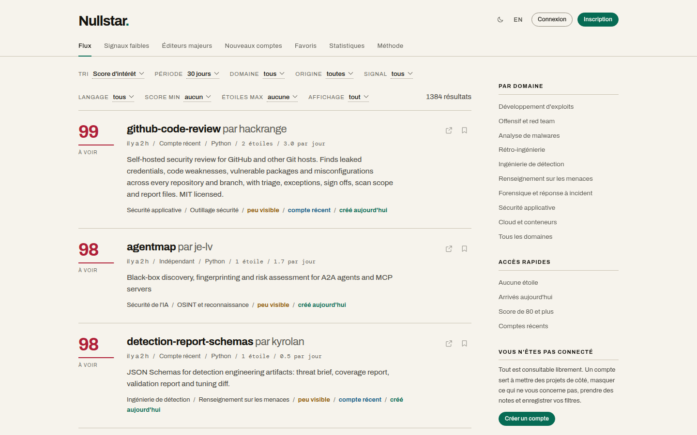
</p>

<table>
  <tr>
    <td width="50%">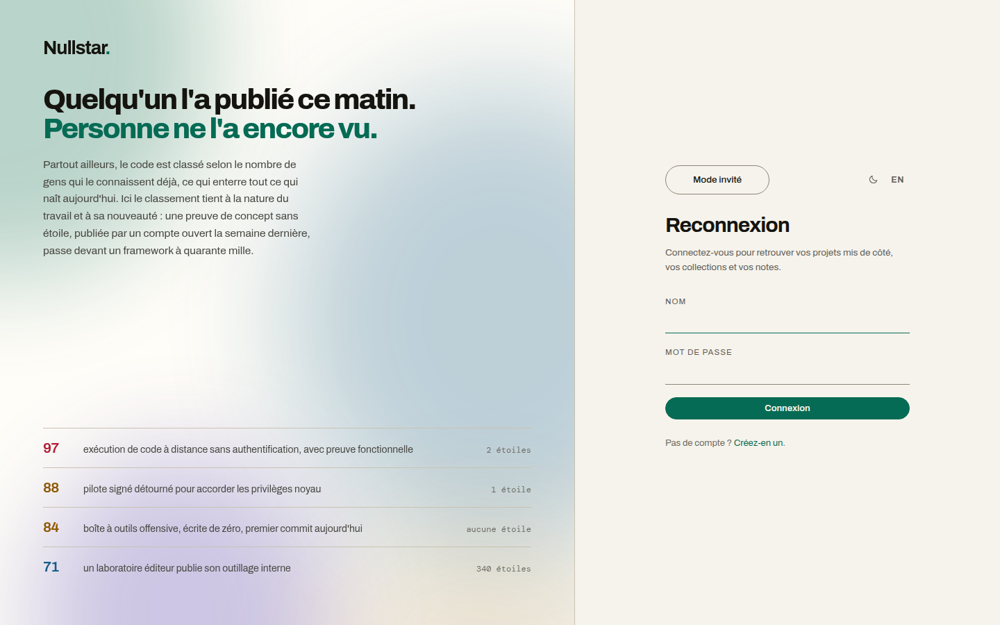<br><sub>Page d'accueil : connexion, inscription ou mode invite</sub></td>
    <td width="50%">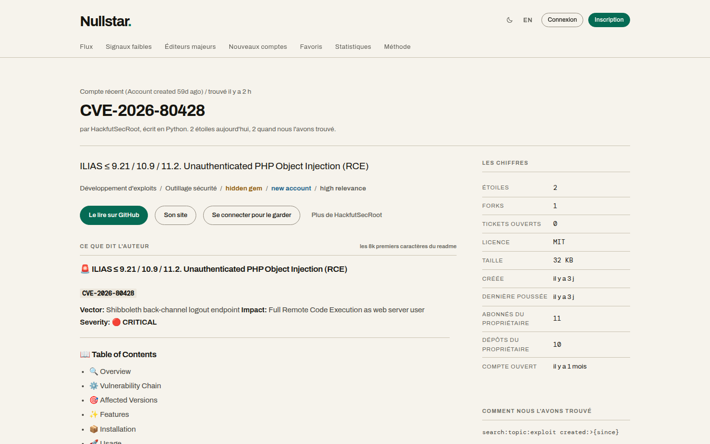<br><sub>Fiche de depot avec le readme assaini et les chiffres</sub></td>
  </tr>
  <tr>
    <td width="50%">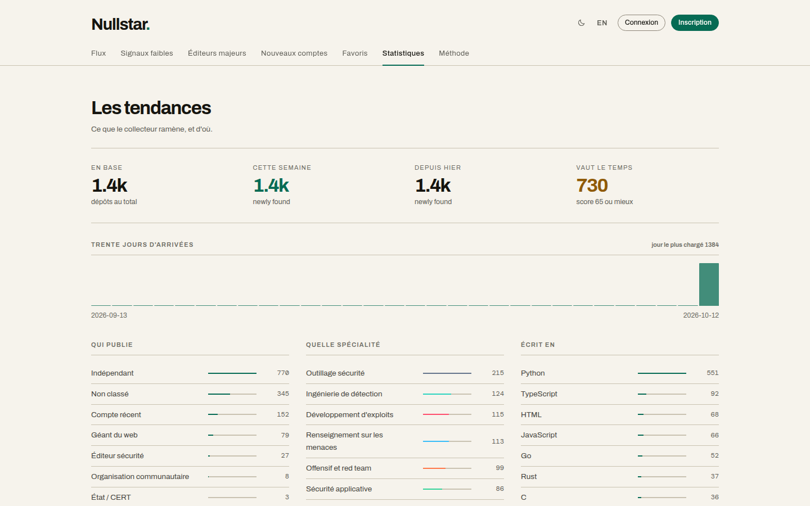<br><sub>Statistiques : qui publie, quel domaine, quel langage</sub></td>
    <td width="50%">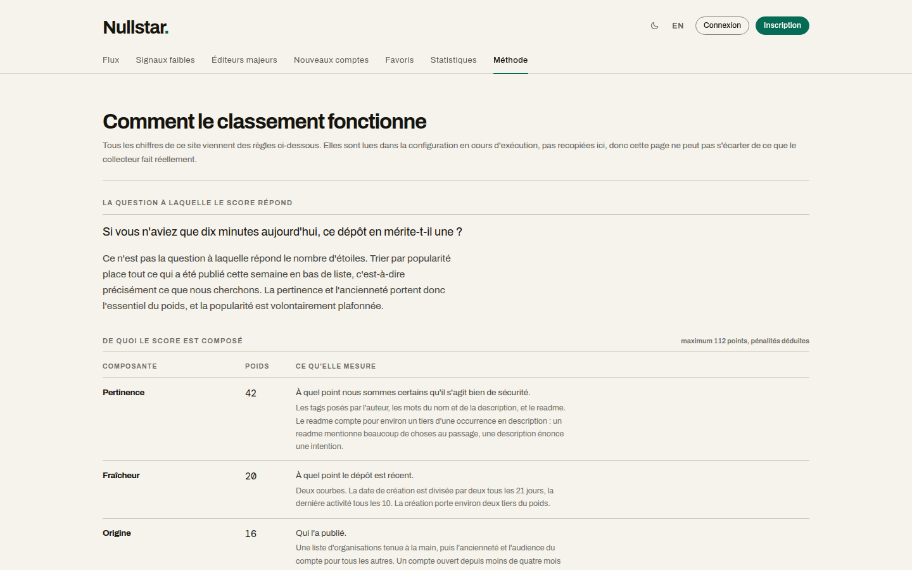<br><sub><code>/how</code>, la methode de calcul generee depuis la configuration en cours</sub></td>
  </tr>
  <tr>
    <td colspan="2">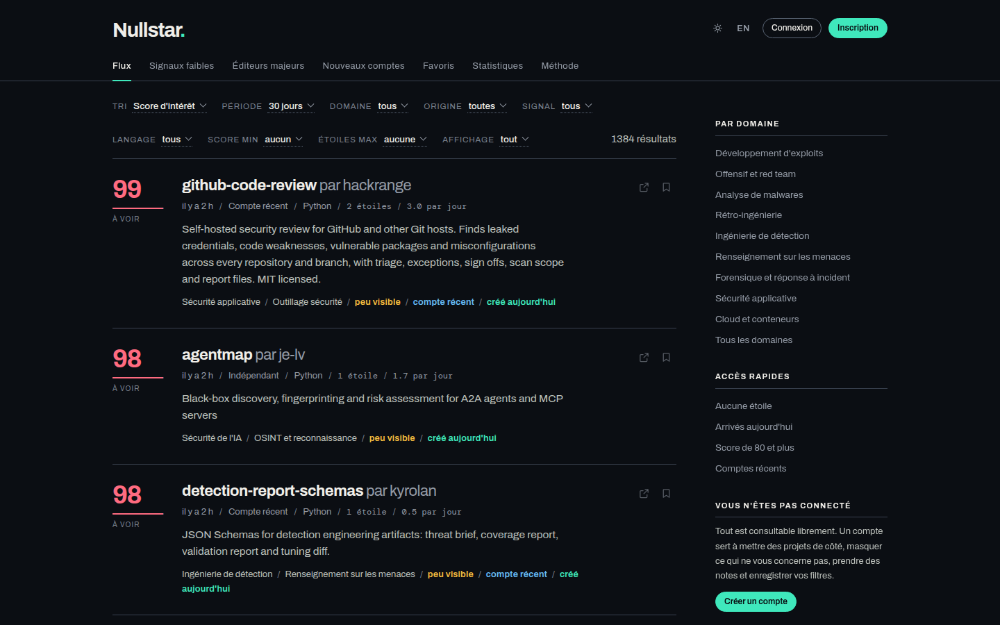<br><sub>Mode sombre</sub></td>
  </tr>
</table>


## Installation

```
cp .env.example .env
$EDITOR .env
docker compose up -d --build
```

Ouvrez http://127.0.0.1:8080. Une premiere visite arrive sur la page de
connexion, qui sert aussi de page d'accueil : elle explique de quoi il s'agit et
propose trois portes, se connecter, s'inscrire, ou **Mode invite**. Le mode
invite est memorise, cette page n'apparait donc qu'une fois.

Rien n'est derriere un mur d'inscription. Le flux, les selections, les fiches de
depot, les graphiques, la page de methode et le flux temps reel fonctionnent
pour un visiteur anonyme, et un lien direct vers un depot ou une collection
partagee s'ouvre directement, sans detour.

Un compte ne sert qu'a ce qui appartient a une personne : projets mis de cote,
collections, notes et cles d'API. Le premier compte cree est administrateur de
l'instance.

Un jeton GitHub n'est pas obligatoire mais il le faut en pratique. Sans lui le
collecteur est limite a 60 requetes par heure, ce qui ne suffit a rien. Avec, on
passe a 5000. Un jeton classique en lecture seule, sans aucune portee, suffit
puisque tout ce qui est lu est public. Il peut aussi etre colle plus tard depuis
les pages d'administration.

Raccourcis : `make up`, `make logs`, `make collect`, `make test`, `make reset`.

L'application tourne aussi sans Docker, sur SQLite :

```
python3 -m venv .venv && .venv/bin/pip install -r requirements.txt
.venv/bin/uvicorn app.main:app --host 127.0.0.1 --port 8080
```


## Ou il cherche

Quatre types de sources, toutes modifiables depuis l'administration.

**Requetes de recherche.** Une trentaine. Certaines par tag (`topic:exploit`,
`topic:llm-security`), d'autres par intention (`"proof of concept" exploit`,
`rce OR lpe OR sandbox-escape`). Les secondes comptent plus qu'il n'y parait :
la plupart des nouveaux projets ne sont jamais tagues, et c'est precisement la
que se trouvent les depots a zero etoile.

**Organisations.** Une quarantaine, de Meta, Google et Project Zero a Trail of
Bits, Project Discovery, NCC, Bishop Fox, SpecterOps, Synacktiv et Quarkslab,
jusqu'a la CISA, la NSA et l'ANSSI.

**Comptes dont on suit les etoiles.** Ce qu'une courte liste de chercheurs vient
d'etoiler. C'est le signal le plus precoce qui existe : quelqu'un qui connait le
domaine et qui etoile un depot inconnu devance tout le monde de plusieurs jours.

**Comptes suivis.** La production d'une personne en particulier.

La collecte est continue. Plutot qu'un balayage par heure, un cycle toutes les
quatre-vingt-dix secondes interroge les deux sources les moins recemment
consultees. Avec environ quatre-vingts sources, chacune repasse a peu pres toutes
les heures, mais les resultats arrivent au fil de l'eau et le quota d'API est
depense regulierement au lieu d'une rafale qui declenche le limiteur secondaire
de GitHub. Un balayage complet subsiste toutes les quelques heures pour qu'une
source en erreur ne sorte pas silencieusement de la rotation.

**Du neuf, pas du remis a jour.** Les listings d'organisations sont pour
l'essentiel vieux de plusieurs annees. Un depot cree il y a plus de
`max_repo_age_days` jours (60 par defaut) est ignore, meme s'il a recu un commit
il y a une heure. Ce qui nous interesse, c'est ce qui n'existait pas le mois
dernier, pas un projet de longue date qui vient d'etre modifie.


## Le calcul du score

Une seule question : si vous n'aviez que dix minutes aujourd'hui, ce depot en
merite-t-il une ?

| Composante | Poids | Ce qu'elle mesure |
| --- | --- | --- |
| Pertinence | 42 | A quel point c'est bien de la securite. Tags, description, readme, vingt vocabulaires de domaine |
| Fraicheur | 20 | Age, demi-vie 21 jours, et derniere activite, demi-vie 10 jours |
| Origine | 16 | Geant du web, editeur, laboratoire, Etat, communaute, chercheur connu, compte recent |
| Substance | 12 | Description, profondeur du readme, tags, licence, taille |
| Dynamique | 10 | Etoiles par jour, fortement compressee pour que la popularite ne decide pas de tout |
| Bonus de visibilite | +12 | Pertinent, recent, presque personne ne l'a vu |
| Penalite de bruit | -30 | Listes de liens, supports de cours, forks, depots archives |

Chaque page de depot affiche son propre calcul, y compris les termes exacts qui
ont correspondu. Les poids sont modifiables, et recalculer tout l'historique ne
touche pas a l'API GitHub.

L'instance publie tout cela sur **`/how`**, une page accessible a tous, generee
depuis la configuration en cours d'execution et non depuis une copie, pour
qu'elle ne puisse pas s'ecarter de ce que le collecteur fait vraiment.


## Comptes

La lecture est ouverte. Le flux, les selections, les fiches de depot, les
graphiques et le flux temps reel fonctionnent sans compte.

L'inscription demande un nom et un mot de passe. Pas de champ email,
volontairement : ici une adresse ne servirait a rien, puisqu'aucun courrier
n'est envoye, et ce serait une donnee de plus a perdre en cas de fuite.

Un compte apporte :

- mettre des depots de cote, et masquer ceux qu'on ne veut plus voir
- des collections : des dossiers que vous nommez et colorez. Un depot peut etre
  dans plusieurs. Tri par date d'ajout, score, etoiles, age, nom, ou votre ordre
- un lien de partage par collection, lisible par tous, revocable, renouvelable
- des notes privees, sur un depot et sur la raison du classement
- le suivi de comptes GitHub, dont les nouveautes sont signalees
- des filtres enregistres et des cles d'API

Le premier compte cree est administrateur. L'inscription libre est active par
defaut et un administrateur peut la fermer, auquel cas `/register` n'accepte
plus qu'une invitation a usage unique. Trois roles : admin, analyste, lecteur.


## Securite

| Probleme | Ce qui le traite |
| --- | --- |
| XSS | Echappement Jinja partout, plus un assainisseur de readme qui retire les balises au lieu de les rendre. CSP avec `script-src 'self'`, sans `unsafe-inline` ni `unsafe-eval` |
| Injection SQL | ORM avec parametres lies partout. Aucun SQL construit par concatenation |
| Depassement d'entier | Les parametres numeriques sont analyses et bornes. SQLite leve au-dela de 2**63, ce qui donne une 500 depuis une simple URL |
| CSRF | Jeton double soumission sur chaque formulaire, comparaison a temps constant |
| Redirection ouverte | `next` doit etre un chemin interne. `//hote`, `/\hote`, un schema ou un caractere de controle retombent sur `/` |
| Cassage de mot de passe | Argon2id, rehache a la connexion si les parametres changent |
| Bourrage d'identifiants | Verrouillage par compte, plus une limite par adresse IP tous comptes confondus |
| Inondation d'inscriptions | Limite par adresse IP sur la creation de comptes |
| Detournement de clic | `X-Frame-Options: DENY`, `frame-ancestors 'none'` |
| Vol de session | Cookie signe HttpOnly SameSite adosse a une session en base, revocable |
| SSRF | Le webhook d'alerte n'accepte que http et https |
| Fuite vers des tiers | Aucun CDN, polices auto-hebergees, `connect-src 'self'`, `Referrer-Policy: no-referrer` |

La suite de tests comprend une batterie d'entrees hostiles qui envoie des
charges script, SQL, traversee de repertoire et injection de gabarit sur chaque
parametre, puis analyse le HTML produit pour verifier qu'aucun element ni
attribut d'evenement n'a ete cree.

Deux failles reelles ont ete trouvees par ces tests pendant le developpement et
corrigees : une redirection `/\hote` que les navigateurs traitent comme
protocol-relative, et un filtre d'etoiles non borne qui faisait planter SQLite.


## Interface

Theme clair par defaut, sombre sur demande. Le choix est un cookie et se trouve
aussi sur le compte, donc la page s'affiche directement dans le bon theme au
lieu de clignoter.

Anglais et francais. Seule l'interface est traduite : les noms, descriptions et
readme des depots restent tels que leurs auteurs les ont ecrits.

Les menus deroulants sont un composant maison, parce qu'un `select` natif n'est
pas stylable au-dela de son etat ferme. Le vrai `select` reste dans le DOM,
masque, donc les formulaires envoient les memes valeurs et tout fonctionne sans
JavaScript. Clavier, saisie rapide et champ de filtre sur les longues listes
sont geres.

Toutes les couleurs de texte respectent WCAG AA sur leur fond, dans les deux
themes.


## Contribuer

```
python3 -m venv .venv
.venv/bin/pip install -r requirements.txt
.venv/bin/python -m pytest tests -q
```

Les tests tournent sur SQLite et ne demandent aucun reseau. Si vous touchez au
scoring ou a l'assainisseur, ajoutez un cas. Si vous ajoutez une source qui
donne de bons resultats, proposez-la : la liste de sources est ce qu'il est le
plus utile de faire grandir.


## Licence

MIT, voir LICENSE.
